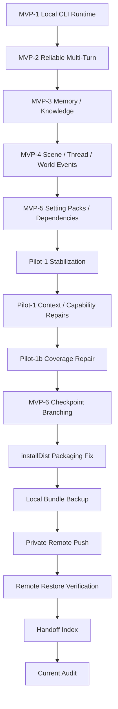

# Project Completion Loop Audit

Date: 2026-06-20

## Verdict

PASS_WITH_CONTROL_DOC_DRIFT.

The engine is stable through MVP-6 and backed up to a private GitHub remote. The next work should not be MVP-7. The next smallest milestone should refresh project control documents so they match the real post-MVP-6 state.

## Confirmed Current State

- Current branch before this audit: `codex/mvp6-checkpoint-branching-spec`
- Remote: `https://github.com/z72124223/ai-novel-engine.git`
- Latest pushed stable commit before this audit: `65c298517f8d6b5794b6fe0a7056e80874b66041`
- Stable integration commit before the handoff doc: `514120afdc0b87b2e5ff6bdbe01701e6a288e491`
- Release tag: `mvp-6`
- `mvp-6` target: `be527031335efe8e2b0facae0145e1bbc084f8c6`
- Remote restore clone: PASS on 2026-06-20
- Remote restore test: `gradlew.bat clean test --no-daemon`
- Test result from restored clone: 220 tests, 0 failures, 0 errors, 0 skipped
- Local test reports currently show 220 tests across 10 suites.

## Completion Map



## Completed Milestones

| Area | Status | Evidence |
| --- | --- | --- |
| MVP-1 local CLI runtime | Complete | `mvp-2` and later history builds on it; tests still include base `EngineTest`. |
| MVP-2 reliable multi-turn runtime | Complete | tag `mvp-2`; `MultiTurnRuntime.kt`; multi-turn docs and tests preserved. |
| MVP-3 memory and knowledge runtime | Complete | tag `mvp-3`; `MemoryKnowledgeServices.kt`; memory/knowledge docs preserved. |
| MVP-4 scene/thread/world events | Complete | tag `mvp-4`; `SceneThreadServices.kt`; scene thread tests preserved. |
| MVP-5 setting packs/dependency graph | Complete | tag `mvp-5`; `SettingPackServices.kt`; setting pack tests preserved. |
| Pilot-1 stabilization repairs | Complete | tags `pilot-1-stabilized`, `pilot-1-budget-v2`, `pilot-1-context-normalized`, `pilot-1-context-relevance`, `pilot-1-capability-contract`. |
| Pilot-1b coverage repair | Complete | tag `pilot-1b-coverage-repair`; `docs/PILOT1B_COVERAGE_REPAIR.md`; `Pilot1bCoverageRepairTest`. |
| MVP-6 checkpoint branching runtime | Complete | tag `mvp-6`; `TimelineServices.kt`; `Mvp6CheckpointBranchingRuntimeTest`; `docs/MVP6_CLI_ACCEPTANCE.md`. |
| installDist packaging repair | Complete | commit `514120a`; `:app:installDist` and distribution CLI were verified before handoff. |
| Local bundle backup | Complete | bundle created and verified locally before remote push. |
| Private remote backup | Complete | private GitHub repo remote configured and pushed. |
| Remote restore verification | Complete | temp clone saw branch, tags, `mvp-6`, and passed 220 tests. |
| Handoff index | Complete | `docs/HANDOFF.md`; commit `65c2985`; pushed to remote. |

## Existing Runtime Capabilities

- Kotlin/JVM CLI only.
- SQLite persistence with migrations `001` through `006`.
- JSON file turn protocol.
- Manual/Codex-authored AI result JSON, validated before state mutation.
- Multi-turn sessions with pending context lifecycle, `stateVersion`, `contextHash`, and idempotency checks.
- Character memory, knowledge claims, recall logs, emotion deltas, and knowledge-boundary validation.
- Scene lifecycle, story threads, location-aware transitions, world clock, and scheduled world events.
- Setting pack parse, validate, diff, impact preview, transaction apply, export/import, dependency graph, and active-session guard.
- Context hard max: 24576 actual UTF-8 bytes.
- Context normalization, budget forensics, relevance floor, and referenced capability contracts.
- Checkpoint creation, forked sessions, branch checkout, replay-chain verification, and redacted timeline export.
- Windows `installDist` distribution now includes `app.jar` and can launch CLI.

## Already Planned But Not Yet Approved

| Candidate | Status | Notes |
| --- | --- | --- |
| MVP-7 | NOT_APPROVED | `VERIFY.md` says MVP-7 must start with a focused `docs/MVP7_*.md` spec first. |
| Control docs refresh | RECOMMENDED | Root `ROADMAP.md`, `docs/ROADMAP.md`, and `docs/HANDOFF.md` should be updated to reflect post-MVP-6 and remote-backup reality. |
| Remote branch strategy | OPTIONAL | Only two branches were pushed intentionally. Historical `feat/*` and `fix/*` branches remain local unless user approves more pushes or pruning. |
| Branch protection / GitHub repo settings | OPTIONAL | Private repo exists, but no evidence of branch protection or default branch policy has been configured. |
| Runtime or product expansion | BLOCKED | Needs explicit user milestone and spec. |

## Technical Debt

| Debt | Status | Evidence / Note |
| --- | --- | --- |
| Root `ROADMAP.md` stale current milestone | OPEN | It still says MVP-6 stabilization is current and MVP-6 CLI acceptance is next. |
| `docs/ROADMAP.md` stale installDist note | OPEN | It still lists installDist as later non-blocking debt, but packaging repair is complete. |
| `docs/HANDOFF.md` stable HEAD drift | OPEN | It records `514120a`, while handoff commit `65c2985` is now pushed. This audit commit will move HEAD again. |
| `master` is old baseline | OPEN | `docs/HANDOFF.md` already warns `master` is not current stable line. |
| Remote only has two branches | ACCEPTED_FOR_NOW | Intentional from previous remote push milestone. |
| No documented GitHub branch protection | OPEN | Not needed for local backup, but useful before collaborative work. |

## Temporarily Not Doing

- MVP-7.
- Web server, Web UI, HTTP API, port listener.
- Android UI.
- OpenAI API or any external AI call.
- Docker.
- Rust.
- Embedding or vector database.
- Multi-agent runtime.
- Direct SQLite writes by Codex/AI.
- Migration edits outside an explicitly approved additive migration milestone.
- Retagging `mvp-6`.
- Pushing generated or sensitive local artifacts: `data/`, `out/`, `backups/`, build output, Gradle cache, temp JDK.

## Recommended Next Milestone

Next smallest milestone:

```text
project control docs refresh
```

Scope:

- Update `ROADMAP.md` current/next milestone state.
- Update `docs/ROADMAP.md` to mark MVP-6 and installDist packaging repair as complete.
- Update `docs/HANDOFF.md` so the stable point references the latest pushed/audited state.
- Do not implement product behavior.
- Do not start MVP-7.

Suggested commit message:

```text
docs: refresh project control state after MVP-6 backup
```

Required verification:

```powershell
git diff --check
gradlew.bat clean test --no-daemon
git status
```

## Next Prompt

```text
請執行下一個最小 milestone：「project control docs refresh」。

請先閱讀 AGENTS.md、docs/HANDOFF.md、docs/PROJECT_COMPLETION_AUDIT.md、ROADMAP.md、docs/ROADMAP.md、DONE_CRITERIA.md、VERIFY.md。

只更新控制文件，使它們符合目前已確認狀態：
- MVP-6 complete
- installDist repair complete
- local bundle backup complete
- private remote push complete
- remote restore verification complete

不要開 MVP-7，不要改程式碼，不要改 schema，不要 retag，不要 merge，不要 push，除非完成後我明確批准。
```
