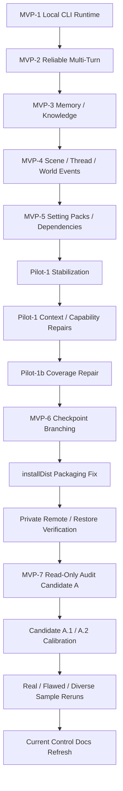

# Project Completion Loop Audit

Date: 2026-06-20

## Verdict

PASS_WITH_PRODUCT_DECISION_PENDING.

The engine is stable through MVP-6, backed up to a private GitHub remote, and has completed the approved MVP-7 read-only audit track through Candidate A.2 plus additional sample reruns. The remaining work is not an unblocked implementation task: moving beyond read-only audit work requires either real author-led story samples or an explicit new candidate decision. Candidate B is not approved.

## Confirmed Current State

- Current branch: `codex/mvp6-checkpoint-branching-spec`
- Remote: `https://github.com/z72124223/ai-novel-engine.git`
- Latest synchronized branch state before this audit refresh: `a2e5a6f31f7d10483022e6e9e04a45c7cdeba63c`
- Release tag: `mvp-6`
- `mvp-6` target: `be527031335efe8e2b0facae0145e1bbc084f8c6`
- Latest verified tests: 233 tests, 0 failures, 0 errors, 0 skipped.
- Latest verified Java: Temurin JDK 17.0.19.
- `audit-narrative-quality` remains read-only and requires no `--db`.
- Ignored generated audit outputs remain under `out/` and are not committed.

## Completion Map



## Completed Milestones

| Area | Status | Evidence |
| --- | --- | --- |
| MVP-1 local CLI runtime | Complete | Base schema, CLI, samples, validator/reducer tests preserved. |
| MVP-2 reliable multi-turn runtime | Complete | tag `mvp-2`; session/pending-context/state-version runtime. |
| MVP-3 memory and knowledge runtime | Complete | tag `mvp-3`; memory/knowledge docs and tests preserved. |
| MVP-4 scene/thread/world events | Complete | tag `mvp-4`; scene/thread/world-event runtime and soak evidence. |
| MVP-5 setting packs/dependency graph | Complete | tag `mvp-5`; setting pack import/export/dependency tests preserved. |
| Pilot-1 stabilization repairs | Complete | tags `pilot-1-stabilized`, `pilot-1-budget-v2`, `pilot-1-context-normalized`, `pilot-1-context-relevance`, `pilot-1-capability-contract`. |
| Pilot-1b coverage repair | Complete | tag `pilot-1b-coverage-repair`; `docs/PILOT1B_COVERAGE_REPAIR.md`. |
| MVP-6 checkpoint branching runtime | Complete | tag `mvp-6`; `TimelineServices.kt`; `docs/MVP6_CLI_ACCEPTANCE.md`. |
| installDist packaging repair | Complete | Distribution CLI verified with `help` and `init-db` in prior milestone. |
| Local/private remote backup | Complete | Private GitHub remote configured and stable branch/tags pushed. |
| Remote restore verification | Complete | Remote restore smoke completed before MVP-7 read-only track. |
| Handoff/control docs | Complete and refreshed | `docs/HANDOFF.md`, root `ROADMAP.md`, this audit file. |
| MVP-7 narrative quality spec draft | Complete | `docs/MVP7_NARRATIVE_QUALITY_SPEC.md`. |
| MVP-7 Candidate A read-only audit | Complete | `audit-narrative-quality` CLI and tests; no SQLite write path. |
| Candidate A.1 calibration | Complete | Context-quality observations and known false-positive reduction. |
| Audit sample collection | Complete | `docs/MVP7_AUDIT_SAMPLE_COLLECTION_REPORT.md`. |
| Flawed audit sample pack | Complete | `samples/mvp7_flawed_audit_pack/`; report documents expected catches and gaps. |
| Candidate A.2 planning and implementation | Complete | `docs/MVP7_CANDIDATE_A2_CALIBRATION_PLAN.md`; read-only audit calibration tests. |
| A.2 real sample rerun | Complete | `docs/MVP7_A2_REAL_SAMPLE_RERUN_REPORT.md`. |
| Audit JSON robustness investigation | Complete | `docs/MVP7_AUDIT_JSON_ROBUSTNESS_INVESTIGATION.md`; root cause was PowerShell UTF-8 decoding. |
| Audit JSON verification hardening | Complete | `VERIFY.md` now requires explicit UTF-8 JSON parsing for audit reports. |
| Diverse audit sample rerun | Complete | `docs/MVP7_DIVERSE_AUDIT_SAMPLE_RERUN_REPORT.md`; 16 non-Pilot samples, no new noisy failures. |

## Existing Runtime Capabilities

- Kotlin/JVM CLI only.
- SQLite persistence with migrations `001` through `006`.
- JSON file turn protocol.
- Manual/Codex-authored AI result JSON validated before formal state mutation.
- Multi-turn sessions with pending context lifecycle, `stateVersion`, `contextHash`, and idempotency checks.
- Character memory, knowledge claims, recall logs, emotion deltas, and knowledge-boundary validation.
- Scene lifecycle, story threads, location-aware transitions, world clock, and scheduled world events.
- Setting pack parse, validate, diff, impact preview, transaction apply, export/import, dependency graph, and active-session guard.
- Context hard max: 24576 actual UTF-8 bytes.
- Context normalization, budget forensics, relevance floor, and referenced capability contracts.
- Checkpoint creation, forked sessions, branch checkout, replay-chain verification, and redacted timeline export.
- Windows `installDist` distribution with packaged migrations.
- Read-only narrative quality audit for context/result/evidence JSON.

## Current Open Decisions

| Decision | Status | Notes |
| --- | --- | --- |
| Candidate B / pre-resolve gate | NOT_APPROVED | Requires explicit decision brief and user approval. |
| Candidate A.3 | NOT_APPROVED | Could be drafted if the user selects a small read-only improvement. |
| New real story samples | WAITING_FOR_AUTHOR_INPUT | Stronger audit calibration needs author-led story arcs outside the existing Pilot/fixture set. |
| MVP-8 | NOT_APPROVED | Must not start without a new spec and explicit approval. |
| Schema changes | NOT_APPROVED | Existing migrations `001` through `006` are stable; no migration work is selected. |

## Technical Debt And Watchpoints

| Item | Status | Evidence / Note |
| --- | --- | --- |
| Candidate B readiness | OPEN | A.2/diverse samples show audit stability but not gate readiness. |
| Sample diversity | OPEN | Existing sample set is still mostly Pilot and synthetic E2E/soak artifacts. |
| Audit report JSON verification | MITIGATED | `VERIFY.md` now documents explicit UTF-8 parsing for PowerShell 5.1. |
| `docs/HANDOFF.md` drift | MITIGATED_BY_THIS_REFRESH | Handoff now reflects MVP-7 read-only audit track. |
| `master` is old baseline | ACCEPTED_FOR_NOW | Current stable integration branch is `codex/mvp6-checkpoint-branching-spec`. |
| Branch protection / GitHub settings | OPTIONAL | Not required for current local/remote backup goal. |

## Temporarily Not Doing

- Candidate B.
- Candidate A.3 unless explicitly selected as a separate milestone.
- MVP-8.
- Web server, Web UI, HTTP API, port listener.
- Android UI.
- OpenAI API or any external AI call.
- Docker.
- Rust.
- Embedding or vector database.
- Multi-agent runtime.
- Direct SQLite writes by Codex/AI.
- Migration edits outside an explicitly approved additive migration milestone.
- Retagging `mvp-6`.
- Pushing generated or sensitive local artifacts: `data/`, `out/`, `backups/`, build output, Gradle cache, temp JDK.

## Recommended Next Milestone

The next milestone should be selected only from current evidence.

Safe options:

1. `collect real author-led story arc samples`: requires user-provided or explicitly approved story turns.
2. `define a new explicit MVP-7 candidate`: documentation-only decision brief first; do not implement by default.
3. `remote restore smoke on demand`: clone from GitHub and rerun tests if backup confidence is needed.

Not safe without approval:

- Candidate B.
- Runtime write-path changes.
- Schema changes.
- Any server/API/UI/external-AI infrastructure.

## Next Prompt

```text
Continue the automatic stable-completion loop.
First read AGENTS.md, PLANS.md, ROADMAP.md, VERIFY.md, DONE_CRITERIA.md, docs/HANDOFF.md, and docs/PROJECT_COMPLETION_AUDIT.md.
Do not enter Candidate B, MVP-8, schema changes, Validator/stateVersion/contextHash changes, resolve-turn/StateReducer changes, server/API/UI/Docker/Rust/embedding work, or direct SQLite writes without explicit approval.
Choose the next smallest milestone from current evidence, update PLANS.md, verify with git diff --check and gradlew.bat clean test --no-daemon, commit only passing work, and push to the current branch when appropriate.
```
