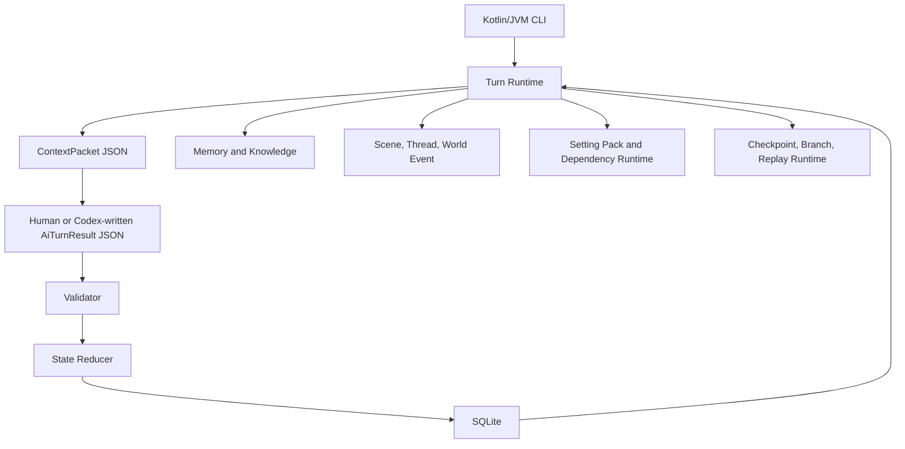
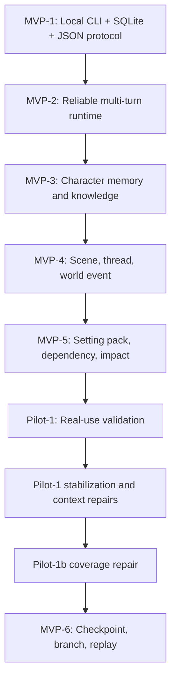

# Project Structure Report

Report version: 2026-06-19

Workspace: `C:\Users\f7212\OneDrive\文件\AI 劇本`

Purpose: This report gives a stable, repeatable overview of the local interactive fiction engine, its runtime layers, data model milestones, current branch state, and recommended next step.

## 1. Verdict

Current status: MVP-6 implementation is present in the working tree and tests pass, but the MVP-6 code has not yet been committed.

Recommended next step: seal the current stable point with a commit, then run one manual MVP-6 CLI acceptance flow.

## 2. Current Snapshot

| Field | Value |
| --- | --- |
| Branch | `codex/mvp6-checkpoint-branching-spec` |
| HEAD | `a8131a2 docs: draft MVP-6 checkpoint branching spec` |
| Test command last run | `gradlew.bat clean test --no-daemon` |
| Test result | `220 tests, 0 failures, 0 errors` |
| Working tree | Dirty, MVP-6 implementation not committed |
| Runtime type | Kotlin/JVM CLI |
| Storage | Local SQLite |
| Protocol | Local JSON files |
| Network/server/API | Not used |

## 3. System Map



## 4. Directory Overview

| Path | Role |
| --- | --- |
| `README.md` | Human-facing local CLI guide |
| `AGENTS.md` | Repo-specific Codex operating rules |
| `docs/` | Architecture, data model, protocol, validation, MVP and Pilot specs |
| `samples/` | Demo seed, sample context/result JSON, setting pack fixtures |
| `app/src/main/kotlin/` | Kotlin source code |
| `app/src/main/resources/migrations/` | SQLite migrations |
| `app/src/test/kotlin/` | Unit and E2E-style regression tests |
| `gradle/`, `gradlew`, `gradlew.bat` | Gradle wrapper |

## 5. Runtime Layers

| Layer | Main Files | Responsibility |
| --- | --- | --- |
| CLI | `app/src/main/kotlin/com/localnovel/engine/Main.kt` | Parses commands and calls runtime services |
| Models | `app/src/main/kotlin/com/localnovel/engine/model/Models.kt` | JSON protocol and domain data classes |
| Repository | `app/src/main/kotlin/com/localnovel/engine/repository/SqliteStoryRepository.kt` | SQLite reads, writes, transactions, migrations |
| Base Turn Flow | `ContextCompiler.kt`, `AiTurnResultValidator.kt`, `StateReducer.kt`, `TurnRunner.kt` | MVP-1 style compile, validate, apply flow |
| Multi-turn Runtime | `MultiTurnRuntime.kt` | Sessions, stateVersion, contextHash, pending turn resolution |
| Memory and Knowledge | `MemoryKnowledgeServices.kt` | Runtime memories, beliefs, knowledge boundary |
| Scene Runtime | `SceneThreadServices.kt` | Scene lifecycle, threads, transitions, world events |
| Setting Packs | `SettingPackServices.kt` | Parse, validate, diff, impact preview, apply setting packs |
| Context Budget | `ContextBudgetForensicsServices.kt`, `ContextPacketNormalizationServices.kt`, `ContextRelevanceFloorServices.kt`, `PilotStabilizationServices.kt` | Context byte fitting, audit, semantic floor, compact records |
| Capability Contracts | `CapabilityContractServices.kt` | Technique/item/weapon capability constraints |
| Timeline Runtime | `TimelineServices.kt` | MVP-6 checkpoints, branches, checkout, replay audit |

## 6. Migration Timeline

| Migration | Status | Purpose |
| --- | --- | --- |
| `001_init.sql` | Existing, unchanged | Base project, character, scene, fact, secret, turn tables |
| `002_multi_turn_runtime.sql` | Existing, unchanged | Sessions, pending turns, stateVersion/runtime session state |
| `003_memory_knowledge_runtime.sql` | Existing, unchanged | Character memory and knowledge boundary |
| `004_scene_thread_runtime.sql` | Existing, unchanged | Scene instances, requirements, transitions, threads, world events |
| `005_setting_pack_runtime.sql` | Existing, unchanged | Setting packs, revisions, dependency and impact analysis |
| `006_checkpoint_branching_runtime.sql` | New in working tree | Timeline branches, session checkpoints, replay audit |

## 7. Main CLI Capability Groups

| Group | Example Commands |
| --- | --- |
| Database | `init-db`, `seed-demo`, `show-state` |
| Single-turn Protocol | `compile-context`, `validate-result`, `apply-result`, `run-manual-turn` |
| Multi-turn Runtime | `start-session`, `show-session`, `prepare-turn`, `resolve-turn`, `abort-pending-turn` |
| Pilot Audit | `audit-context`, `explain-context-budget`, `pilot-preflight`, `export-session-evidence` |
| Scene Runtime | `show-scene`, `show-threads`, `show-world-events`, `preview-transitions` |
| Character Runtime | `show-character-mind`, `explain-capability` |
| Setting Pack Runtime | `parse-setting-pack`, `validate-setting-pack`, `diff-setting-pack`, `impact-preview`, `apply-setting-pack` |
| MVP-6 Timeline | `create-checkpoint`, `list-checkpoints`, `show-checkpoint`, `fork-session`, `checkout-branch`, `show-timeline`, `verify-replay-chain`, `export-timeline` |

## 8. MVP and Pilot Milestone Map



## 9. Current Working Tree Changes

MVP-6 files currently modified or added:

| Path | Type | Meaning |
| --- | --- | --- |
| `app/src/main/kotlin/com/localnovel/engine/Main.kt` | Modified | Adds MVP-6 CLI commands |
| `app/src/main/kotlin/com/localnovel/engine/model/Models.kt` | Modified | Adds checkpoint, branch, replay, timeline models |
| `app/src/main/kotlin/com/localnovel/engine/repository/SqliteStoryRepository.kt` | Modified | Adds migration 006, branch-aware session persistence |
| `app/src/main/kotlin/com/localnovel/engine/service/ContextPacketNormalizationServices.kt` | Modified | Allows branch/checkpoint context fields |
| `app/src/main/kotlin/com/localnovel/engine/service/MultiTurnRuntime.kt` | Modified | Adds branch-aware context and active-branch mutation guard |
| `app/src/main/kotlin/com/localnovel/engine/service/TimelineServices.kt` | Added | Checkpoint, fork, checkout, timeline export, replay audit |
| `app/src/main/resources/migrations/006_checkpoint_branching_runtime.sql` | Added | Additive MVP-6 schema |
| `app/src/test/kotlin/com/localnovel/engine/Mvp6CheckpointBranchingRuntimeTest.kt` | Added | MVP-6 regression tests |

## 10. Test Status

| Command | Result |
| --- | --- |
| `gradlew.bat clean test --no-daemon` | PASS |
| Total tests | 220 |
| Failures | 0 |
| Errors | 0 |

## 11. Safety Boundaries

| Boundary | Current Status |
| --- | --- |
| No web server | Preserved |
| No listening port | Preserved |
| No external AI API | Preserved |
| No Android UI | Preserved |
| No Rust | Preserved |
| No Docker | Preserved |
| No embedding/vector DB | Preserved |
| AI cannot directly write SQLite | Preserved by JSON result plus Validator plus transaction apply |
| Validator before apply/resolve | Preserved |
| stateVersion/contextHash checks | Preserved |

## 12. Recommended Next Action

Seal the MVP-6 implementation:

```powershell
git diff --check
git status
git add .
git commit -m "feat: implement checkpoint branching runtime"
```

Then run one manual MVP-6 acceptance flow:

```powershell
gradlew.bat clean test --no-daemon
gradlew.bat :app:run --args="create-checkpoint --db data/<db>.db --session <session-id> --label before-fork"
gradlew.bat :app:run --args="fork-session --db data/<db>.db --checkpoint <checkpoint-id> --label alternate-branch"
gradlew.bat :app:run --args="show-timeline --db data/<db>.db --project <project-id>"
gradlew.bat :app:run --args="verify-replay-chain --db data/<db>.db --session <session-id>"
gradlew.bat :app:run --args="export-timeline --db data/<db>.db --project <project-id> --out out/timeline_export.json"
```

## 13. Plain-language Summary

This project is now a local story engine that stores canon and runtime state in SQLite, exchanges turns through JSON files, and protects story progression with validation, context budgets, memory boundaries, capability contracts, scene rules, and branch-aware timeline controls.

The most important current fact: MVP-6 is implemented and passing tests, but not yet committed. Commit it before starting any new design work.
