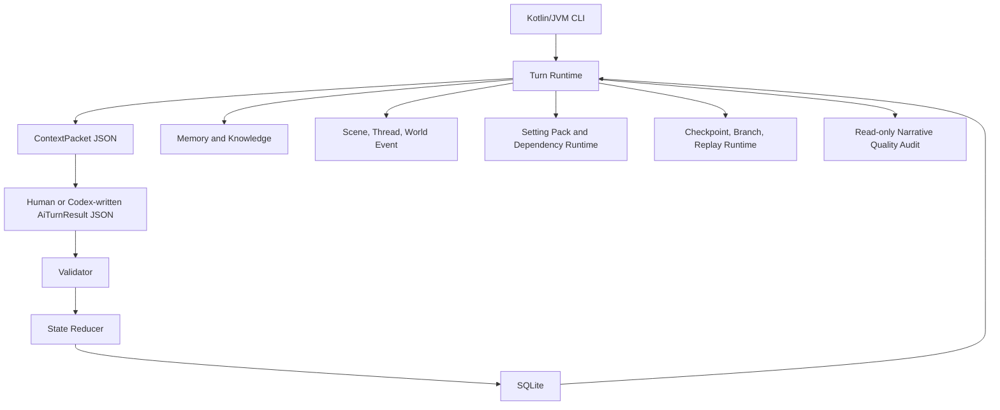
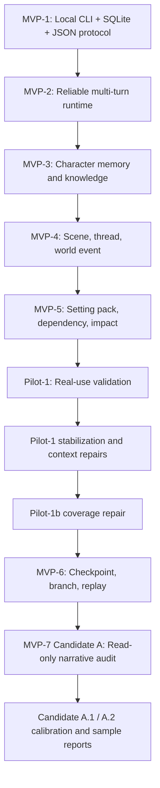

# Project Structure Report

Report version: 2026-06-20

Local directory register update: 2026-06-24

Workspace: `C:\Users\f7212\Projects\AI 劇本`

Purpose: This report gives a stable, repeatable overview of the local interactive fiction engine, its runtime layers, data model milestones, current branch state, and recommended next step.

## 1. Verdict

Current status: MVP-6 is sealed and tagged, installDist packaging is repaired, the private GitHub remote is synchronized, and the approved MVP-7 work so far is limited to read-only narrative quality audit tooling and reports.

Recommended next step: do not enter Candidate B automatically. Either collect real author-led story arc samples, draft a new explicit MVP-7 candidate brief, or run a remote restore smoke check on demand.

## 2. Current Snapshot

| Field | Value |
| --- | --- |
| Branch | `codex/mvp6-checkpoint-branching-spec` |
| Remote | `origin https://github.com/z72124223/ai-novel-engine.git` |
| Latest synchronized evidence before this report | `3cf9a8081bb05a8e68bb85060e71d663d1d527bc` |
| MVP-6 tag | `be527031335efe8e2b0facae0145e1bbc084f8c6` |
| Test command last run | `gradlew.bat clean test --no-daemon` |
| Test result | `233 tests, 0 failures, 0 errors, 0 skipped` |
| Working tree expectation | Clean before starting a new milestone |
| Runtime type | Kotlin/JVM CLI |
| Storage | Local SQLite |
| Protocol | Local JSON files |
| Network/server/API | Not used |
| Approved MVP-7 scope so far | Read-only audit only |
| Candidate B | Not approved |

## 3. System Map



## 4. Directory Overview

| Path | Role |
| --- | --- |
| `README.md` | Human-facing local CLI guide |
| `AGENTS.md` | Repo-specific Codex operating rules |
| `ROADMAP.md` | Current milestone selection and project control roadmap |
| `PLANS.md` | Active milestone plan and drift log |
| `DONE_CRITERIA.md` | Completion gates for every milestone |
| `VERIFY.md` | Required verification commands and triage order |
| `docs/` | Architecture, data model, protocol, validation, MVP/Pilot/MVP-7 docs |
| `memory/` | Local repo memory capsules and directory memory files; not runtime SQLite memory |
| `C:\Users\f7212\OneDrive\文件\小說朗讀` | Standalone local Node.js CLI project for novel-to-narrated-video work; outside this Kotlin/JVM engine repo, see `docs/PROJECT_DIRECTORY_AND_SUBPROJECT_REGISTER.md` |
| `samples/` | Demo seed, sample context/result JSON, setting pack and audit fixtures |
| `app/src/main/kotlin/` | Kotlin source code |
| `app/src/main/resources/migrations/` | SQLite migrations |
| `app/src/test/kotlin/` | Unit and E2E-style regression tests |
| `gradle/`, `gradlew`, `gradlew.bat` | Gradle wrapper |

## 5. Runtime Layers

| Layer | Main Files | Responsibility |
| --- | --- | --- |
| CLI | `app/src/main/kotlin/com/localnovel/engine/Main.kt` | Parses commands and calls runtime services |
| Models | `app/src/main/kotlin/com/localnovel/engine/model/Models.kt` | JSON protocol and domain data classes |
| Repository | `app/src/main/kotlin/com/localnovel/engine/repository/SqliteStoryRepository.kt` | SQLite reads, writes, transactions, migrations |
| Base Turn Flow | `ContextCompiler.kt`, `AiTurnResultValidator.kt`, `StateReducer.kt`, `TurnRunner.kt` | MVP-1 style compile, validate, apply flow |
| Multi-turn Runtime | `MultiTurnRuntime.kt` | Sessions, `stateVersion`, `contextHash`, pending turn resolution |
| Memory and Knowledge | `MemoryKnowledgeServices.kt` | Runtime memories, beliefs, knowledge boundary |
| Scene Runtime | `SceneThreadServices.kt` | Scene lifecycle, threads, transitions, world events |
| Setting Packs | `SettingPackServices.kt` | Parse, validate, diff, impact preview, apply setting packs |
| Context Budget | `ContextBudgetForensicsServices.kt`, `ContextPacketNormalizationServices.kt`, `ContextRelevanceFloorServices.kt`, `PilotStabilizationServices.kt` | Context byte fitting, audit, semantic floor, compact records |
| Capability Contracts | `CapabilityContractServices.kt` | Technique/item/weapon capability constraints |
| Timeline Runtime | `TimelineServices.kt` | MVP-6 checkpoints, branches, checkout, timeline export, replay audit |
| Narrative Audit | `NarrativeQualityAuditService.kt` | Read-only MVP-7 Candidate A/A.1/A.2 audit report over JSON files |

## 6. Migration Timeline

| Migration | Status | Purpose |
| --- | --- | --- |
| `001_init.sql` | Existing, unchanged | Base project, character, scene, fact, secret, turn tables |
| `002_multi_turn_runtime.sql` | Existing, unchanged | Sessions, pending turns, `stateVersion`/runtime session state |
| `003_memory_knowledge_runtime.sql` | Existing, unchanged | Character memory and knowledge boundary |
| `004_scene_thread_runtime.sql` | Existing, unchanged | Scene instances, requirements, transitions, threads, world events |
| `005_setting_pack_runtime.sql` | Existing, unchanged | Setting packs, revisions, dependency and impact analysis |
| `006_checkpoint_branching_runtime.sql` | Existing, sealed in MVP-6 | Timeline branches, session checkpoints, replay audit |

## 7. Main CLI Capability Groups

| Group | Example Commands |
| --- | --- |
| Database | `init-db`, `seed-demo`, `show-state` |
| Single-turn Protocol | `compile-context`, `validate-result`, `apply-result`, `run-manual-turn` |
| Multi-turn Runtime | `start-session`, `show-session`, `prepare-turn`, `resolve-turn`, `abort-pending-turn` |
| Pilot Audit | `audit-context`, `explain-context-budget`, `pilot-preflight`, `export-session-evidence` |
| Scene Runtime | `show-scene`, `show-threads`, `show-world-events`, `preview-transitions` |
| Character Runtime | `show-character-mind`, `explain-capability` |
| Setting Pack Runtime | `create-setting-pack-template`, `validate-setting-pack`, `preview-setting-import`, `apply-setting-pack`, `diff-setting-pack`, `impact-report`, `export-setting-pack`, `show-dependencies` |
| MVP-6 Timeline | `create-checkpoint`, `list-checkpoints`, `show-checkpoint`, `fork-session`, `checkout-branch`, `show-timeline`, `verify-replay-chain`, `export-timeline` |
| MVP-7 Read-only Audit | `audit-narrative-quality --context <path> --result <path> [--evidence <path>] [--out <path>]` |

## 8. MVP and Pilot Milestone Map



## 9. Current Working Tree Expectation

There should be no uncommitted runtime work before selecting a new milestone.

Use:

```powershell
git status --short --branch
git log --oneline --decorate -10
```

Expected:

- Working tree clean.
- Branch synchronized with `origin/codex/mvp6-checkpoint-branching-spec`, unless a new verified milestone is in progress.
- `mvp-6` still points to `be527031335efe8e2b0facae0145e1bbc084f8c6`.

## 10. Test Status

| Command | Result |
| --- | --- |
| `gradlew.bat clean test --no-daemon` | PASS |
| Total tests | 233 |
| Failures | 0 |
| Errors | 0 |
| Skipped | 0 |

## 11. Safety Boundaries

| Boundary | Current Status |
| --- | --- |
| No web server | Preserved |
| No listening port | Preserved |
| No external AI API | Preserved |
| No Android UI | Preserved |
| No Rust | Preserved |
| No Docker | Preserved |
| No embedding/vector DB | Preserved |
| AI cannot directly write SQLite | Preserved by JSON result plus Validator plus transaction apply |
| Validator before apply/resolve | Preserved |
| `stateVersion` / `contextHash` checks | Preserved |
| Candidate B gate behavior | Not approved |

## 12. Recommended Next Action

Do not start Candidate B automatically.

Safe next options:

1. Collect real author-led story arc audit samples when available.
2. Draft a new explicit MVP-7 candidate brief if the user chooses a small read-only improvement.
3. Run a remote restore smoke check on demand.

## 13. Plain-language Summary

This project is now a local story engine that stores canon and runtime state in SQLite, exchanges turns through JSON files, and protects story progression with validation, context budgets, memory boundaries, capability contracts, scene rules, and branch-aware timeline controls.

MVP-6 is sealed. MVP-7 work so far is only a read-only narrative quality audit, plus calibration and sample reports. The system is stable, but more product progress now needs either real story samples or an explicit new candidate decision.
